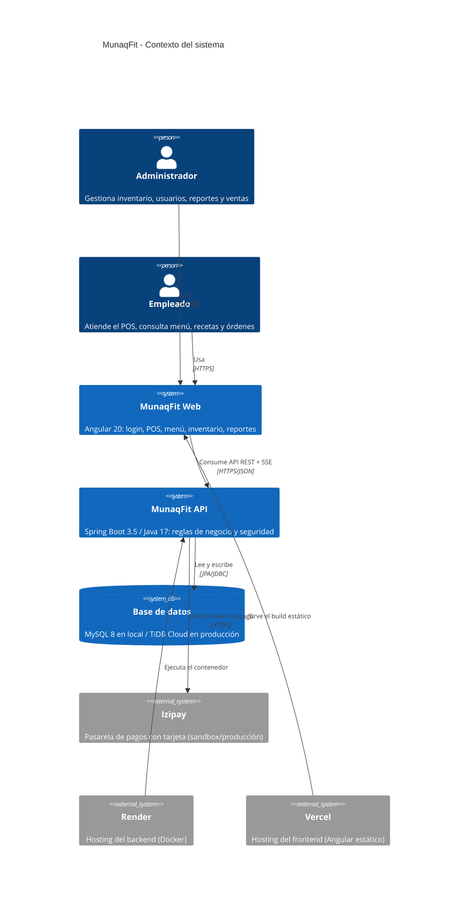
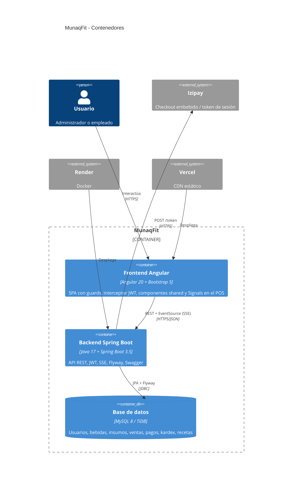
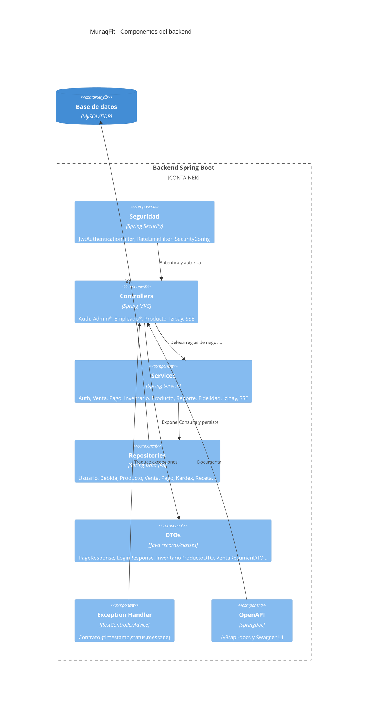

# Arquitectura de MunaqFit

Este documento cubre el punto **3.4** de la rúbrica: diagramas C4 (contexto,
contenedores y componentes) y la separación de capas del backend.

## 1. C4 - Contexto

## 2. C4 - Contenedores

## 3. C4 - Componentes del backend

## 4. Capas y dependencias

| Capa | Paquete | Responsabilidad | Depende de |
|:--|:--|:--|:--|
| Entrada HTTP | `controller` | Validar parámetros, llamar servicios, devolver DTOs | `service`, `dto`, `security` |
| Negocio | `service` | Reglas de venta, pago, inventario, reportes, auth | `repository`, `model`, `dto` |
| Persistencia | `repository` | Consultas Spring Data / JPQL | `model` |
| Modelo | `model` | Entidades JPA | — |
| Contratos | `dto` | Request/Response y `PageResponse` | — |
| Seguridad | `security`, `config` | JWT, rate limit, CORS, Swagger | `service`, `repository` |
| Errores | `exception` | Contrato uniforme de errores | — |

**Flujo típico:** `Controller → Service → Repository → MySQL`.
Los controllers simples de administración (usuarios, proveedores, menú) aún
usan el repositorio directamente; es una deuda técnica menor que se puede
refactorizar sin cambiar la API.

## 5. Decisiones relevantes

- **Paginación estándar:** `PageResponse<T>` con `contenido`, `pagina`,
  `tamano`, `totalElementos`, `totalPaginas`.
- **Ordenamiento:** `?orden=campo,asc|desc` con lista blanca por endpoint.
- **Seguridad:** access token de 15 min + refresh de 7 días rotado con `jti`.
- **Tiempo real:** SSE para alertas de stock, con keep-alive y reconexión.
- **Pagos:** Izipay server-side; en local `IZIPAY_MOCK=true` simula la aprobación.
- **Migraciones:** Flyway (`V1`–`V13`) es la fuente del esquema y del catálogo
  de bebidas/recetas.
